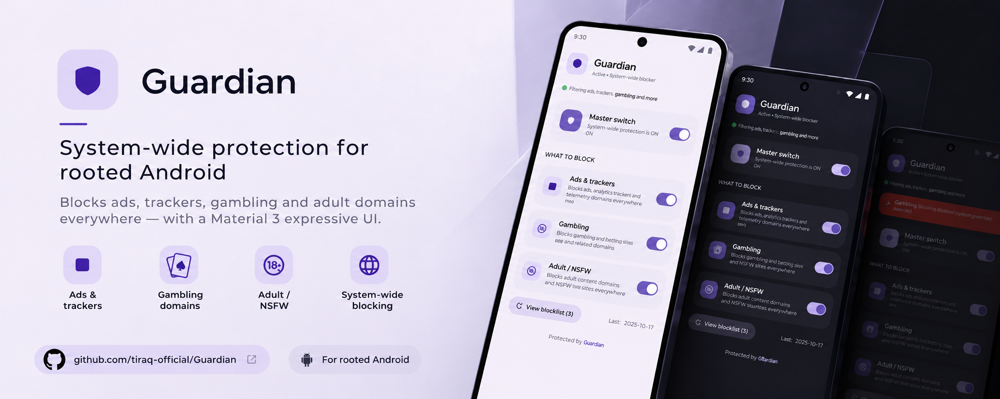

# Guardian

**System-wide ads / gambling / adult-site blocker for rooted Android**, with a
Material 3 Expressive WebUI.

  

## What it does

- Blocks ads, trackers, malware, gambling and adult domains **everywhere** —
  every app and browser — by swapping your system `hosts` file.
- **Master switch** plus independent **Ads**, **Gambling** and **Adult**
  toggles, each with its own list.
- WebUI follows your system accent (Material You) and light/dark theme.
- ~500,000 domains bundled, so it works offline right after flashing.
- Toggles apply instantly; one-tap blocklist update.

Works on **Magisk, KernelSU / KernelSU-Next, APatch, FolkPatch, SukiSU**.

## Install

1. Download `Guardian-v1.0.zip`.
2. Root manager → Modules → Install from storage → pick the zip.
3. Reboot, then open the module's WebUI and set your toggles.

> If one site still loads, turn off your browser's own secure DNS
> (Chrome → Settings → Privacy and security → Use secure DNS → Off).

## Blocklist sources

| Category | Domains | Source |
|---|---:|---|
| Ads & trackers | ~278k | [HaGeZi Pro.plus](https://github.com/hagezi/dns-blocklists), [StevenBlack](https://github.com/StevenBlack/hosts), [AdGuard DNS filter](https://github.com/AdguardTeam/AdGuardSDNSFilter) |
| Gambling | ~134k | [HaGeZi Gambling](https://github.com/hagezi/dns-blocklists) |
| Adult / NSFW | ~92k | [HaGeZi NSFW](https://github.com/hagezi/dns-blocklists) |

## Credits & license

Made by **Saptak Maji**, licensed **GPL-3.0** (required — the bundled lists are
GPL-3.0). Thanks to HaGeZi, StevenBlack and AdGuard for the lists, and to the
KernelSU, Magisk and APatch projects for the module format.
