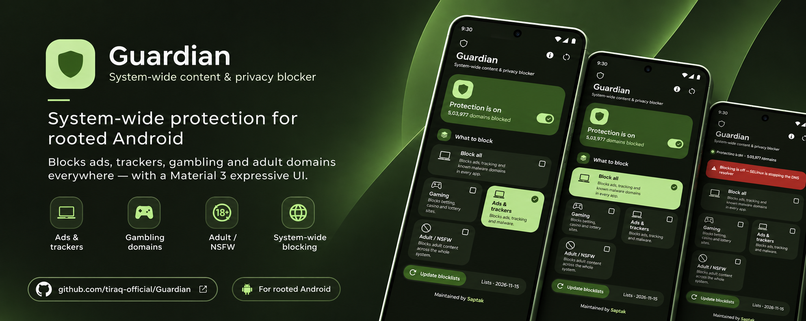

# Guardian

**System-wide ads / gambling / adult-site blocker for rooted Android**, with a
Material 3 Expressive WebUI.

  

## What it does

- Blocks ads, trackers, malware, gambling and adult domains **everywhere** —
  every app and browser — by swapping your system `hosts` file.
- **Protection** switch plus a **Block all** card and independent **Ads**,
  **Gambling** and **Adult** cards. Block all fills in automatically when all
  three are on, and clears the moment one is turned off.
- WebUI follows your system accent (Material You) and light/dark theme.
- ~717,000 domains bundled, so it works offline right after flashing.
- Toggles apply instantly; one-tap blocklist update.

Works on **Magisk, KernelSU / KernelSU-Next, APatch, FolkPatch, SukiSU**.

## Install

1. Download `Guardian-v3.0.zip`.
2. Root manager → Modules → Install from storage → pick the zip.
3. Reboot, then open the module's WebUI and set your toggles.

> If one site still loads, turn off your browser's own secure DNS
> (Chrome → Settings → Privacy and security → Use secure DNS → Off).

## Blocklist sources

| Category | Domains | Source |
|---|---:|---|
| Ads & trackers | ~311k | [HaGeZi Pro.plus](https://github.com/hagezi/dns-blocklists), [StevenBlack](https://github.com/StevenBlack/hosts), [AdGuard DNS filter](https://github.com/AdguardTeam/AdGuardSDNSFilter) |
| Gambling | ~94k | [HaGeZi Gambling (medium)](https://github.com/hagezi/dns-blocklists) |
| Adult / NSFW | ~315k | [HaGeZi NSFW](https://github.com/hagezi/dns-blocklists), [Sinfonietta](https://github.com/Sinfonietta/hostfiles), [ShadowWhisperer](https://github.com/ShadowWhisperer/BlockLists) |

The same sources are used by the in-app **Update blocklists** button. All
three toggles on is ~717k unique domains (a ~16 MB hosts file) — if your
device feels sluggish, turn a category off or rebuild with fewer sources.

## Credits & license

Made by **Saptak Maji**, licensed **GPL-3.0** (required — the bundled lists are
GPL-3.0). Thanks to HaGeZi, StevenBlack, Sinfonietta and ShadowWhisperer for
the lists, and to the KernelSU, Magisk and APatch projects for the module
format.
