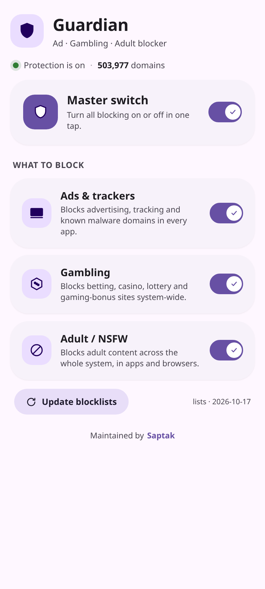
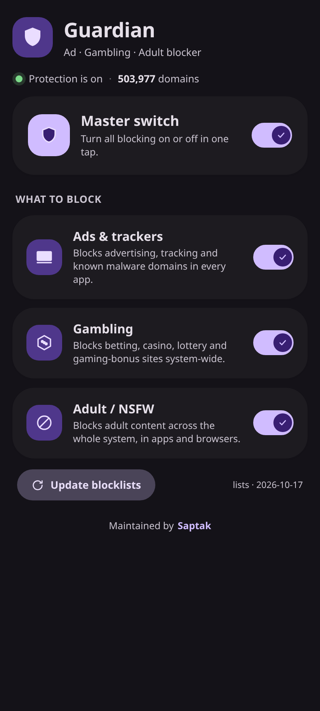
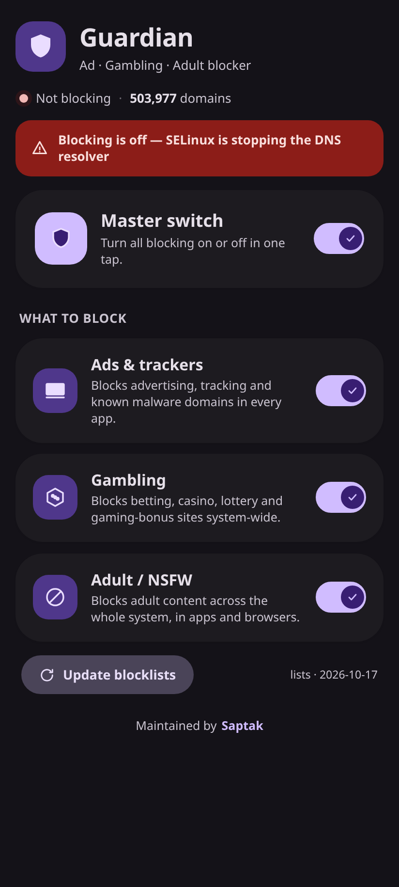

# Guardian

**A system-wide ads / gambling / adult-site blocker for rooted Android, with a
Material 3 Expressive WebUI.**

Guardian swaps your system `hosts` file (via a bind mount) for a compiled
blocklist and lets you control what gets blocked — ads & trackers, gambling,
and adult content — from a native-looking, theme-aware interface.

Works on **Magisk**, **KernelSU / KernelSU-Next**, **APatch**, **FolkPatch**
and **SukiSU Ultra**. The WebUI follows the MMRL / WebUI X standard, so on
KernelSU-Next and with the WebUI X host the colours match your wallpaper
(Material You) and switch automatically between light and dark.

<p align="center">
  
  
  
</p>

---

## Features

- **Master switch** — turn all blocking on or off in one tap.
- **Three independent categories** — Ads & trackers, Gambling, Adult / NSFW.
  Each toggle has its own list, so you can block just what you want.
- **Material 3 Expressive UI** — dynamic colour from the system accent,
  automatic light/dark, springy switches, count-up stats and staggered
  entrance animation.
- **~500,000 domains** bundled, so it works the moment you reboot — no
  internet needed at install time.
- **One-tap blocklist update** straight from the WebUI.
- **No reboot needed to change a toggle** — the hosts file is rebuilt and
  re-mounted instantly (a reboot guarantees every cached lookup is cleared).

## Requirements

- Android with root: Magisk, KernelSU / KernelSU-Next, APatch, FolkPatch or
  SukiSU Ultra.
- For the full themed WebUI: a manager with WebUI support (KernelSU-Next,
  APatch, or Magisk with the **WebUI X** host). On a plain Magisk manager the
  module still installs and works — you just manage it with the Action button
  or by editing `config.conf`.

## Install

1. Download `Guardian-v1.0.0.zip`.
2. Open your root manager → **Modules** → **Install from storage** → pick the
   zip.
3. Reboot.
4. Open the module's **WebUI** (or **Action**) and set your toggles.

## The WebUI

| Control | What it does |
|---|---|
| **Master switch** | Enables/disables the whole module. When off, category cards dim and nothing is blocked. |
| **Ads & trackers** | Advertising, tracking and known-malware domains, in every app. |
| **Gambling** | Betting, casino, lottery and gaming-bonus sites. |
| **Adult / NSFW** | Adult content system-wide. |
| **Update blocklists** | Re-downloads every source and rebuilds the hosts file. |

Tapping the module's **Action** button flips the master switch — handy on
managers without a WebUI.

## How it works

```
flash  ──►  customize.sh seeds /data/adb/guardian (config + lists)
boot   ──►  post-fs-data.sh  builds the hosts file, bind-mounts it
            service.sh       re-applies the mount + optional auto-update
toggle ──►  scripts/webui.sh rebuilds + re-mounts instantly
```

The real `/system/etc/hosts` is never modified — Guardian bind-mounts its own
file over it, so uninstalling restores the stock file on the next reboot.

Everything lives in **`/data/adb/guardian`**:

```
/data/adb/guardian/
├── config.conf        master=1 ads=1 gambling=1 porn=1 autoupdate=0
├── hosts              the compiled hosts file that gets mounted
├── guardian.log       what the module did, and when
└── lists/
    ├── ads.txt        one domain per line
    ├── gambling.txt
    └── porn.txt
```

To change a setting from a terminal (no WebUI needed):

```sh
su -c 'sh /data/adb/modules/saptak_guardian/scripts/webui.sh set ads 0'
su -c 'sh /data/adb/modules/saptak_guardian/scripts/webui.sh status'
su -c 'sh /data/adb/modules/saptak_guardian/scripts/webui.sh update'
```

## Blocklist sources

Guardian's lists are built from these upstream projects (see
`tools/fetch_lists.py`). Counts are the unique domains in the shipped build:

| Category | Domains | Sources |
|---|---:|---|
| Ads & trackers | ~278,000 | [HaGeZi Pro.plus](https://github.com/hagezi/dns-blocklists), [StevenBlack](https://github.com/StevenBlack/hosts), [AdGuard DNS filter](https://github.com/AdguardTeam/AdGuardSDNSFilter) |
| Gambling | ~134,000 | [HaGeZi Gambling (mini)](https://github.com/hagezi/dns-blocklists) |
| Adult / NSFW | ~92,000 | [HaGeZi NSFW](https://github.com/hagezi/dns-blocklists) |

[1Hosts](https://github.com/badmojr/1Hosts), [EnergizedProtection](https://github.com/EnergizedProtection/block)
and Re-Malwack are wired into `tools/fetch_lists.py` as **optional** sources
(see the `OPTIONAL` table) — enable them for a more aggressive build, at the
cost of a larger hosts file.

### A note on size

Very large hosts files can slow DNS lookups (Android does not cache the hosts
file). Guardian defaults to a focused ~500k-domain set. If your device feels
sluggish, drop a category or disable the optional sources and rebuild.

## Updating the lists

- **On device:** tap **Update blocklists** in the WebUI (needs internet).
- **Rebuild offline:** `python3 tools/fetch_lists.py` then `./build.sh`.
- **Auto-update:** set `autoupdate=1` in `/data/adb/guardian/config.conf` to
  refresh weekly at boot.

## Building from source

```sh
python3 tools/fetch_lists.py     # (re)build module/lists/*.txt
python3 tools/make_icon.py       # (re)generate the icon
./build.sh                       # -> dist/Guardian-v1.0.0.zip
```

## Repo layout

```
Guardian/
├── module/                 the module (zipped into the release)
│   ├── module.prop
│   ├── customize.sh        installer
│   ├── post-fs-data.sh     early boot: build + mount hosts
│   ├── service.sh          late boot: re-mount + auto-update
│   ├── action.sh           Action button -> toggle master
│   ├── uninstall.sh
│   ├── sepolicy.rule       SELinux safety net
│   ├── META-INF/           flashable zip entry point
│   ├── scripts/            common.sh, webui.sh, update_lists.sh, diagnose.sh
│   ├── lists/              bundled blocklists
│   └── webroot/            the WebUI (index.html, style.css, app.js)
├── tools/                  fetch_lists.py, make_icon.py
├── docs/                   screenshots
└── build.sh
```

## Troubleshooting

**The toggles are on but nothing is blocked.**

Hosts blocking only works if the DNS resolver (`netd`) is *allowed* to read
the hosts file. A bind mount keeps the **source** file's SELinux label, and
files under `/data/adb` are labelled `adb_data_file`, which `netd` is denied —
so the file gets silently ignored. Guardian relabels the hosts file to
`system_file` before mounting and ships a `sepolicy.rule` as a fallback, so
this should be handled. To check:

```sh
su -c 'sh /data/adb/modules/saptak_guardian/scripts/diagnose.sh'
```

It prints the mount state, the hosts file's SELinux context, recent `netd`
denials and a couple of sample lookups. `label : WRONG` means the relabel
failed. The WebUI also shows a red banner when blocking is not active.

**One particular site still loads.**

1. Check the domain is really in a list:
   `su -c 'grep -i <domain> /data/adb/guardian/hosts'`
2. Turn off the browser's own secure DNS. Chrome's *Secure DNS* and Firefox's
   *DNS-over-HTTPS* resolve names **inside the browser** and bypass the hosts
   file completely. Chrome → Settings → Privacy → **Use secure DNS → Off**.
3. Turn off any VPN.
4. Already-open apps cache DNS — restart the app or reboot.

**It worked and then stopped.** Check the log:
`su -c 'tail -50 /data/adb/guardian/guardian.log'`

## Limitations (please read)

Hosts-based blocking is powerful but not absolute:

- Apps and browsers that use **DNS-over-HTTPS / DNS-over-TLS**, or a **VPN**
  with its own resolver, can bypass the hosts file.
- Some first-party ads are served from the same domain as content and can't be
  blocked without breaking the app.
- Toggling takes effect for **new** lookups immediately; already-running apps
  may hold a cached result until they restart. A reboot clears everything.

For those cases, pair Guardian with a filtering DNS or Private DNS.

## Credits & license

Code © Saptak Maji, licensed under **GPL-3.0** — required because the bundled
blocklists (HaGeZi, GPL-3.0) are redistributed inside the zip. Each upstream
list keeps its own license; see the sources table above.

WebUI theming follows the **MMRL / WebUI X** CSS standard
(`mui.kernelsu.org`). Thanks to the KernelSU, Magisk and APatch projects for
the module format.
